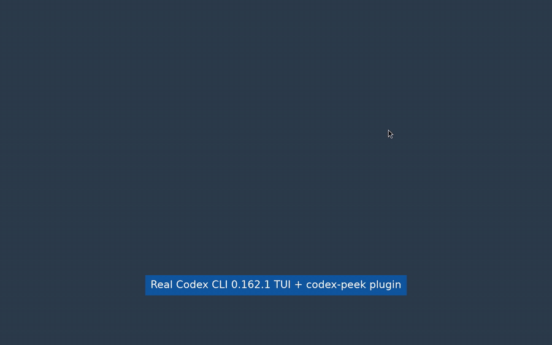
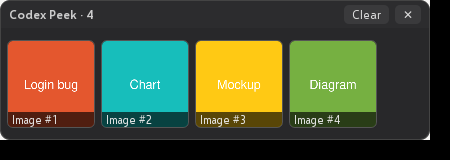

# codex-peek

**See the images you paste into [OpenAI Codex CLI](https://github.com/openai/codex).**

Codex's TUI shows pasted images only as `[Image #1]`, `[Image #2]`… placeholders, so when you paste 3–4 screenshots you can't check which is which. `codex-peek` is a tiny always-on-top floating window that shows numbered thumbnails of every image you paste, in the same order Codex numbers them.

[中文说明](README.zh-CN.md)

<p align="center">
  <a href="docs/demo-real-codex.mp4"></a>
  <br><sub>Real Codex CLI 0.162.1 TUI: window opens with the session, 3× Ctrl+V, enlarge, Clear, closes on /quit · <a href="docs/demo-real-codex.mp4">MP4 (28 s)</a></sub>
</p>

<p align="center">
  <video src="https://raw.githubusercontent.com/hucheng91/codex-peek/main/docs/demo-real-codex.mp4" controls muted width="900"></video>
</p>

<p align="center">
  
  &nbsp;
  
</p>

- Native OS webview (WKWebView on macOS, WebView2 on Windows, WebKitGTK on Linux) via [wry](https://github.com/tauri-apps/wry) + [tao](https://github.com/tauri-apps/tao). No Electron; the binary is **about 0.8 MB** (Linux x64 release build, measured), and macOS/Windows builds are in the same range (see the CI "Binary size" step).
- Numbered thumbnails (`Image #1..N`) in arrival order; click to enlarge, click again to go back.
- **Clear** button (numbering restarts at #1), optional auto-clear after idle (`--idle`).
- Compact, frameless, draggable (drag the title bar); remembers its position.
- **Codex plugin**: opens by itself when a Codex session starts and closes when the session ends.

## How it works

Codex saves each pasted clipboard image to a temp file before attaching it. From
[`codex-rs/tui/src/clipboard_paste.rs`](https://github.com/openai/codex/blob/main/codex-rs/tui/src/clipboard_paste.rs) (`paste_image_to_temp_png`):

```rust
let tmp = Builder::new()            // tempfile crate
    .prefix("codex-clipboard-")
    .suffix(".png")
    .tempfile()?;                   // in std::env::temp_dir()
// ... then tmp.keep() so the file stays around
```

That gives files like `codex-clipboard-Ab3xYz.png` in `std::env::temp_dir()`:

| OS | Directory watched |
|---|---|
| macOS | `$TMPDIR` (e.g. `/var/folders/xx/…/T/`) |
| Windows | `%TEMP%` (`GetTempPath2W`, usually `C:\Users\<you>\AppData\Local\Temp`) |
| Linux | `$TMPDIR` or `/tmp` |
| WSL | Codex falls back to PowerShell `Get-Clipboard` and saves to the **Windows** temp dir with a random `tmpXXXX.png` name, not `codex-clipboard-*`. Run codex-peek on Windows with `--pattern "tmp*.png"` (see Limitations). |

`codex-peek` checks that directory every 400 ms and shows any matching file created after it started.

## Install

### Option A: Codex plugin (recommended, starts and stops by itself)

```sh
codex plugin marketplace add hucheng91/codex-peek
codex plugin add codex-peek@codex-peek
```

The plugin ties the window to the Codex session in two ways:

1. **MCP server (main path).** Codex starts plugin MCP servers as soon as a session boots and stops them when it exits. The plugin's `.mcp.json` runs `node bin/codex-peek-mcp.js`, which finds or downloads the native binary and runs `codex-peek --mcp`. That process is a minimal MCP server with no tools. It opens the window (detached, shared between sessions) and holds a localhost socket open to it. When Codex exits, or kills the server, the socket closes and the window closes. It needs `node` on PATH, which npm installs of Codex already have. No trust prompt is needed.
2. **Lifecycle hooks (fallback, e.g. without node).** **SessionStart** runs `bin/codex-peek-hook start` and **SessionEnd** runs `... stop`. Codex skips plugin hooks until you trust them (run `/hooks` once). Codex also runs SessionStart **lazily, on the first submitted turn** (`codex-rs/core/src/session/turn.rs` → `run_pending_session_start_hooks`). So in hook-only mode the window first appears after your first prompt, and it then picks up images from the last 10 minutes. Codex kills a hook's whole process tree when the hook finishes, so the window leaves it: it calls `setsid` on Unix, and on Windows it uses `CREATE_BREAKAWAY_FROM_JOB`, which Codex's job object allows.

With several Codex sessions open, they share one window, and it closes when the last session ends.

To pass options, set `CODEX_PEEK_ARGS`, e.g. `export CODEX_PEEK_ARGS="--idle 120"`. To use a local build, set `CODEX_PEEK_BIN=/path/to/codex-peek`.

### Option B: run it manually

```sh
npx codex-peek            # downloads the native binary for your OS and runs it
# or download a binary from GitHub Releases, or build it:
cargo build --release && ./target/release/codex-peek
```

### Options

```
--dir <PATH>        Directory to watch (default: OS temp dir)
--pattern <GLOB>    Filename glob (default: codex-clipboard-*.png)
--idle <SECONDS>    Auto-clear after N seconds without new images (0 = off, default)
--existing          Also show matching files from the last 10 minutes
--port <N>          Localhost control port (default 47821)
--hook-start / --hook-stop   Codex hook entry points (read hook JSON on stdin)
```

## Limitations

- **Numbering can drift.** codex-peek numbers images in the order the files appear. If you delete an `[Image #N]` placeholder in the composer, Codex renumbers but codex-peek doesn't know. Press **Clear** (or use `--idle`) between prompts.
- Only **clipboard pastes** are captured. Images attached by file path (`codex -i file.png`, dragging a file, typing a path) and **URL images** never go through `codex-clipboard-*.png`, so they don't show up.
- **WSL:** the PowerShell fallback writes `tmpXXXX.png` files to the Windows temp dir. Use `--pattern "tmp*.png"` (this also matches other apps' temp PNGs).
- macOS/Windows binaries are not code-signed yet. The plugin downloads them with `curl`/`Invoke-WebRequest`, which don't add the quarantine flag, but a binary downloaded with a browser may need `xattr -d com.apple.quarantine`.
- If Codex crashes and SessionEnd never runs, the window stays open. Close it with ✕.
- Tested end to end with codex-cli 0.162.1 on Linux/X11. The MCP path needs `node` on PATH. The hook fallback needs `/hooks` trust and only starts on the first prompt.
- On Linux without a compositor, the rounded window corners render as white squares.

## Codex plugin integration: what is and isn't possible

Based on `openai/codex` main (Oct 2026):

| Possible ✅ | Source |
|---|---|
| A plugin can ship lifecycle hooks: `.codex-plugin/plugin.json` → `"hooks": "./hooks/hooks.json"` | `codex-rs/core-plugins/src/manifest.rs` (`resolve_manifest_hooks`) |
| `SessionStart` / `SessionEnd` events (plus PreToolUse, PostToolUse, Stop, …). SessionStart only fires on the first turn | `codex-rs/protocol/src/protocol.rs` `enum HookEventName`, `codex-rs/core/src/session/turn.rs` |
| Plugin MCP servers (`.mcp.json`) start when the session boots and stop when it exits, so they give an exact window lifetime. Set `"cwd": "."` so relative paths resolve to the plugin root, and use `env_vars` to pass `DISPLAY`, `TEMP` and so on | `codex-rs/codex-mcp/src/plugin_config.rs`, `codex-rs/rmcp-client/src/utils.rs` (`DEFAULT_ENV_VARS`) |
| Hook commands get `PLUGIN_ROOT` / `PLUGIN_DATA` env vars; there is a separate `commandWindows` command | `codex-rs/hooks/src/engine/discovery.rs`, `codex-rs/config/src/hook_config.rs` |
| A hook can start a long-lived process if it detaches: Codex kills the hook's process group (Unix) or Job Object (Windows, created with `JOB_OBJECT_LIMIT_BREAKAWAY_OK`) | `codex-rs/hooks/src/engine/command_runner.rs` (`ProcessTreeGuard`), `codex-rs/utils/pty/src/win/job.rs` |
| Install from a Git marketplace (`.agents/plugins/marketplace.json`) | `codex-rs/core-plugins/src/marketplace.rs`, `codex-rs/cli/src/marketplace_cmd.rs` |

| Not possible ❌ |
|---|
| There is no hook or event for "image pasted", and plugins can't draw inside the TUI or composer, so the preview has to be a separate window. |
| Plugin hooks are skipped until the user trusts them (`/hooks`). The MCP path avoids this. |
| An MCP server has a single `command` for all OSes (no `commandWindows`), so the plugin uses `node` as the cross-platform launcher. |
| `SessionEnd` hook timeouts are clamped to 3 s, so the stop hook only sends a message to the window. |
| A plugin can't bundle native binaries per OS, so the hook script downloads them from GitHub Releases. |

## Roadmap

- Native in-composer preview in Codex itself using the kitty graphics protocol or sixel. See openai/codex issues [#29451](https://github.com/openai/codex/issues/29451) and [#35824](https://github.com/openai/codex/issues/35824). A PR there would make this tool unnecessary.
- Re-number when placeholders are deleted (would need a Codex hook or event).
- Signed/notarized macOS builds, a Windows ARM64 build, a Homebrew/winget/Scoop manifest.
- Watch with OS file events instead of polling.

## Development

```sh
cargo test                       # watcher/matching/CLI/control unit tests
npm test                         # npm wrapper tests
DISPLAY=:0 ./scripts/demo.sh     # regenerate docs/screenshot.png + docs/demo.gif (Linux/X11)
```

Linux build deps: `libwebkit2gtk-4.1-dev libgtk-3-dev libxdo-dev`.

## License

MIT
